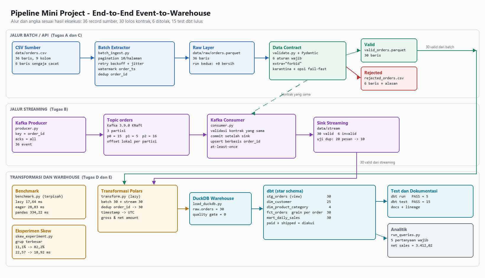

# Mini Project — End-to-End Event-to-Warehouse Pipeline

Pipeline data untuk analisis transaksi e-commerce yang menggabungkan ingestion batch
bergaya REST API, streaming melalui Apache Kafka, validasi data contract, benchmark
transformasi, serta pemodelan analitik dengan dbt di atas DuckDB.

| | |
|---|---|
| Mata Kuliah | Praktikum Data Processing Workflow — D4 Sains Data Terapan, PENS |
| Mahasiswa | Ilham Bintang Satria (NRP 3324600041) |
| Dosen Pengampu | Isbat Uzzin Nadhori, S.Kom., M.T. |
| Teknologi | Python 3.14, Pandas, PyArrow, Pydantic 2, Polars 2, kafka-python, Apache Kafka 3.9 (KRaft, Docker), DuckDB, dbt-duckdb |

Dataset `data/orders.csv` adalah data sintetis bawaan paket praktikum, bukan data
pelanggan nyata. Enam dari 36 barisnya sengaja dibuat cacat untuk menguji data contract.

## Arsitektur



Jalur batch menarik record dari CSV sumber halaman demi halaman, menyimpannya ke raw
layer Parquet, lalu memisahkan record valid dari record yang ditolak kontrak. Jalur
streaming mengirim event yang sama lewat topic Kafka `orders` dan memvalidasinya dengan
kontrak yang sama sebelum ditulis ke sink idempoten. Record valid dimuat ke DuckDB dan
dimodelkan dbt menjadi star schema yang diuji dan didokumentasikan.

## Struktur Repositori

```text
.
├── docker-compose.yml         Kafka single-node mode KRaft, 3 partisi default
├── requirements.txt
├── data/
│   ├── orders.csv             sumber (36 baris, 6 cacat)
│   ├── raw/orders.parquet     hasil batch ingestion
│   ├── valid/                 record lolos kontrak
│   ├── rejected/              record ditolak beserta alasannya
│   ├── stream/                hasil consumer Kafka
│   ├── stream_dup/            hasil uji duplikasi
│   └── watermark.json         checkpoint incremental loading
├── scripts/
│   ├── batch_ingest.py        pagination, retry + backoff + jitter, watermark
│   ├── contract.py            kontrak Pydantic
│   ├── validate.py            validasi batch, karantina per-record, opsi fail-fast
│   ├── producer.py            producer Kafka, key = order_id
│   ├── consumer.py            consumer Kafka, commit setelah sink, upsert order_id
│   ├── benchmark.py           Pandas vs Polars eager vs Polars lazy
│   ├── skew_experiment.py     eksperimen data skew
│   ├── load_duckdb.py         memuat data valid ke warehouse
│   └── run_queries.py         lima pertanyaan analitik wajib
├── warehouse/warehouse.duckdb
├── dbt_project/               model staging, dimensi, fakta, mart, dan tes
├── docs/pipeline.png          diagram arsitektur
└── evidence/                  tangkapan layar hasil eksekusi (E01–E12 dan langkah lain)
```

## Menjalankan Ulang

Seluruh perintah dijalankan dari root repositori di PowerShell, kecuali perintah dbt.

**1. Lingkungan**

```powershell
py -3.14 -m venv .venv
.venv\Scripts\Activate.ps1
python -m pip install --upgrade pip
python -m pip install -r requirements.txt
```

**2. Batch ingestion dan data contract**

```powershell
python scripts/batch_ingest.py --source data/orders.csv --out data/raw --page-size 10
python scripts/batch_ingest.py --source data/orders.csv --out data/raw --fail-rate 0.5
python scripts/validate.py
python scripts/validate.py --fail-fast
```

Repositori ini sudah menyimpan `data/watermark.json` dan `data/raw/orders.parquet` dari
eksekusi sebelumnya, sehingga run berikutnya bersifat inkremental. Untuk mengulang dari
awal, hapus kedua berkas tersebut lebih dulu.

**3. Streaming Kafka** — Docker Desktop harus sudah berjalan.

```powershell
docker compose up -d
docker compose exec kafka /opt/kafka/bin/kafka-topics.sh --create --topic orders --bootstrap-server localhost:9092 --partitions 3 --replication-factor 1
```

Jalankan consumer di terminal pertama, lalu producer di terminal kedua:

```powershell
python scripts/consumer.py
python scripts/producer.py --limit 36
```

Uji duplikasi memakai topic dan folder sink tersendiri agar angkanya tidak tercampur:

```powershell
docker compose exec kafka /opt/kafka/bin/kafka-topics.sh --create --topic orders-dup --bootstrap-server localhost:9092 --partitions 3 --replication-factor 1
python scripts/consumer.py --topic orders-dup --group orders-dup-test --out-dir data/stream_dup
python scripts/producer.py --topic orders-dup --limit 10 --duplicate 10
docker compose down
```

**4. Benchmark dan skew**

```powershell
python scripts/benchmark.py --factor 5000 --repeat 7
python scripts/skew_experiment.py --factor 5000 --skew-ratio 0.8
```

Dataset benchmark dibuat ulang di `data/bench/` dan tidak disimpan di repositori.

**5. Warehouse dan dbt**

Berkas `dbt_project/profiles.yml` menunjuk warehouse dengan path relatif
`../warehouse/warehouse.duckdb`, sehingga perintah dbt harus dijalankan dari dalam folder
`dbt_project` dan tidak perlu disesuaikan dengan lokasi repositori.

```powershell
python scripts/load_duckdb.py
cd dbt_project
dbt debug
dbt run
dbt test
dbt docs generate
dbt docs serve
cd ..
python scripts/run_queries.py
```

## Ringkasan Hasil

| Tahap | Hasil |
|---|---|
| Batch ingestion | 36 record dalam 4 halaman; run kedua tidak menambah baris, total tetap 36 |
| Retry | Kegagalan sementara pulih dengan jeda menaik sekitar 1 lalu 2 detik ditambah jitter |
| Data contract | 30 valid, 6 ditolak (83,33%), masing-masing melanggar satu aturan berbeda |
| Kafka | 36 event tersebar 15 / 5 / 16 ke tiga partisi; 30 valid dan 6 invalid di sink |
| Idempotensi | 20 pesan (10 duplikat) menghasilkan 10 baris unik di sink |
| Benchmark (180.000 baris, median 7 run) | Polars lazy 17,64 ms · Polars eager 28,83 ms · Pandas 334,22 ms |
| Skew | Grup terbesar naik dari 11,1% ke 82,2%; `group_by` 22,57 ms menjadi 18,92 ms |
| DuckDB | 30 baris dimuat, 0 pelanggar kontrak di warehouse |
| dbt | `dbt run` PASS=5, `dbt test` PASS=15 |
| Analitik | Penjualan bersih diakui 3.412,02; kategori tertinggi Electronics; metode bayar terbanyak card |

Angka benchmark dan skew bergantung pada mesin; hasil di atas diukur pada satu laptop
Windows dengan dataset yang diperbesar secara sintetis.

## Bukti Eksekusi

Folder `evidence/` berisi tangkapan layar asli. Bukti wajib mengikuti penamaan E01–E12:

| Kode | Isi |
|---|---|
| E01 | Verifikasi versi Python, pustaka, dbt, dan Docker |
| E02 | Pagination dan metrik run pertama |
| E03 | Run kedua tanpa penggandaan data |
| E04 | Hasil data contract |
| E05 | Broker Kafka dan topic `orders` |
| E06 | Producer dan consumer |
| E07 | Uji duplikasi dan idempotensi sink |
| E08 | Benchmark Pandas vs Polars |
| E09 | Eksperimen data skew |
| E10 | Pemuatan DuckDB dan quality gate |
| E11 | `dbt run` dan `dbt test` |
| E12 | Dokumentasi dan lineage dbt |

Berkas berawalan `T<tahap><langkah>` merekam langkah lain seperti kode dan persiapan.

## Batas Jaminan dan Keterbatasan

- **At-least-once.** Offset di-commit setelah sink berhasil ditulis, sehingga pesan tidak
  hilang bila consumer berhenti sebelum commit. Duplikasi yang timbul dinetralkan oleh
  upsert berbasis `order_id`. Exactly-once end-to-end tidak diklaim, karena transaksi
  Kafka tidak otomatis membuat penulisan ke berkas atau DuckDB menjadi atomik.
- Sumber data berupa CSV lokal yang disimulasikan sebagai REST API; penanganan
  autentikasi, status HTTP, dan `Retry-After` pada API sungguhan belum diuji langsung.
- Benchmark berjalan pada data sintetis di satu mesin, dan sebagian besar selisih
  waktunya berasal dari pembacaan CSV, bukan dari aritmetika.
- Data contract sengaja tidak memakai `strict=True`, karena sumber CSV membuat seluruh
  nilai terbaca sebagai teks dan memerlukan koersi tipe.
- kafka-python 3.0.11 menampilkan `DeprecationWarning` karena serializer berbasis lambda
  belum memakai antarmuka `Serializer` yang baru. Peringatan ini tidak memengaruhi hasil.
